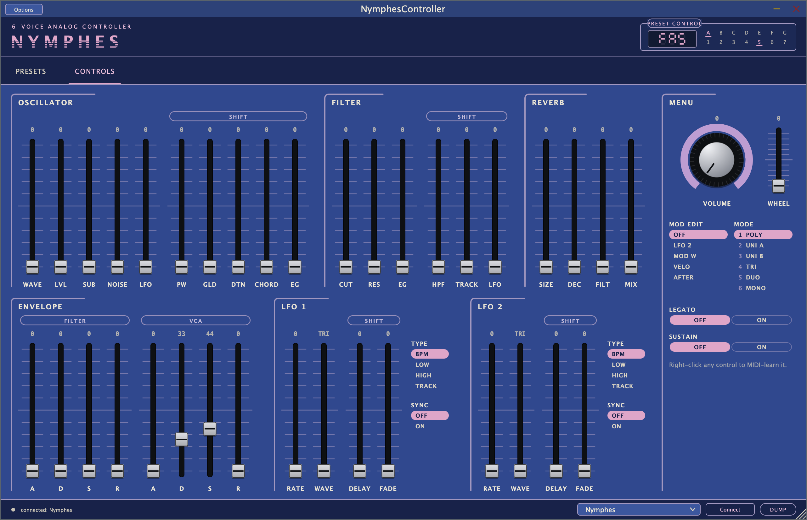
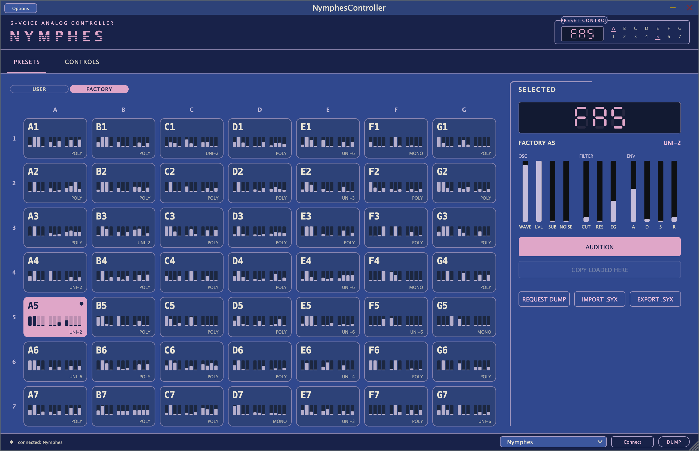

# Nymphes Controller

A VST3 plug-in and standalone app for the **Dreadbox Nymphes**: every MIDI CC
parameter on a panel laid out like the instrument, and a preset browser for the
98 preset slots.

> Unofficial. Not affiliated with or endorsed by Dreadbox. "Nymphes" and
> "Dreadbox" are their trademarks.



## What it does

**Controls.** All 82 Nymphes CCs on one surface, arranged in the hardware's
sections (oscillator, filter, reverb, envelope, LFO 1/2, menu) with the panel's
own short labels. Each section shows its main faders and its SHIFT layer side
by side, so nothing hides behind a button combination.

**Mod edit.** As on the hardware: choose a modulation source in the MENU
(LFO 2, MOD W, VELO, AFTER) and every fader sets that source's depth for its
parameter. A depth the plug-in has not seen yet reads "—" instead of a guess.

**Presets.** The 7 × 7 bank / program grid of PRESET CONTROL, for the USER and
FACTORY pages. Each tile shows a fingerprint of the preset's main voice
settings. Audition sends a preset to the synth without writing its memory.
"Copy loaded here" writes the auditioned preset into a USER slot (after a
confirmation) and reads it back to verify. FACTORY slots are never written.

**MIDI learn.** Right-click any control.



## Install

Download the zip for your platform from
[Releases](../../releases/latest).

### macOS (11+, Apple silicon and Intel)

- **VST3:** copy `NymphesController.vst3` to `~/Library/Audio/Plug-Ins/VST3/`.
- **Standalone:** copy `NymphesController.app` to `/Applications`.

The builds are not notarized. If macOS refuses to open them, clear the
download quarantine once:

```sh
xattr -dr com.apple.quarantine ~/Library/Audio/Plug-Ins/VST3/NymphesController.vst3
xattr -dr com.apple.quarantine /Applications/NymphesController.app
```

### Windows (10/11, x64)

- **VST3:** copy the `NymphesController.vst3` folder to
  `C:\Program Files\Common Files\VST3\`.
- **Standalone:** run `NymphesController.exe`.

Windows MIDI ports are exclusive. If your DAW has the Nymphes enabled as a
MIDI port, the plug-in cannot open it; disable it in the DAW's MIDI settings
and let the plug-in own the port.

## Connecting

The plug-in opens the MIDI port whose name contains "Nymphes" and talks to the
synth directly (CCs and preset SysEx), so it works the same on any track. The
port picker in the status bar selects another port; DUMP reads all 98 presets
from the synth.

## Building

Requires CMake 3.22+ and a C++17 compiler (Xcode / Apple clang on macOS,
Visual Studio 2022 on Windows). JUCE 8.0.12 is fetched automatically; pass
`-DJUCE_DIR=/path/to/JUCE` to use a local checkout.

```sh
cmake -S . -B build -DCMAKE_BUILD_TYPE=Release
cmake --build build --config Release --parallel
ctest --test-dir build -C Release --output-on-failure
```

Artefacts land in `build/NymphesController_artefacts/Release/{VST3,Standalone}`.
On macOS, `./install.sh` builds and installs the VST3.

`nymphes-cli` is a headless preset tool (verify, list, show, split, merge,
read/write a USER slot, send CCs); run it without arguments for usage.

## Layout

```
core/       preset codec: framing, CRC-8, the protobuf payload (no JUCE)
preset/     preset bank and slot model
midi/       MIDI transport: CoreMIDI (macOS), WinMM (Windows); CC map
plugin/     the JUCE processor, CC engine and UI
cli/        nymphes-cli
tests/      CC map, preset safety, mod-edit pairing
tools/      CC map reconciliation, UI capture helper
docs/       build report and notes from how this was built
```

The factory preset dumps and firmware are Dreadbox's files and are not in this
repository. Tests that need them skip when they are absent.
